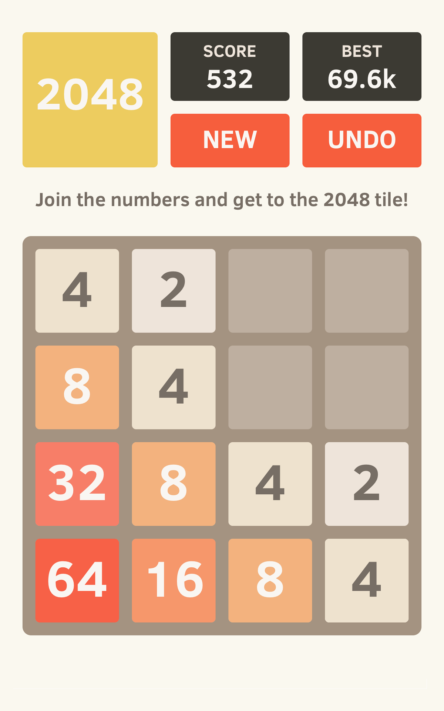
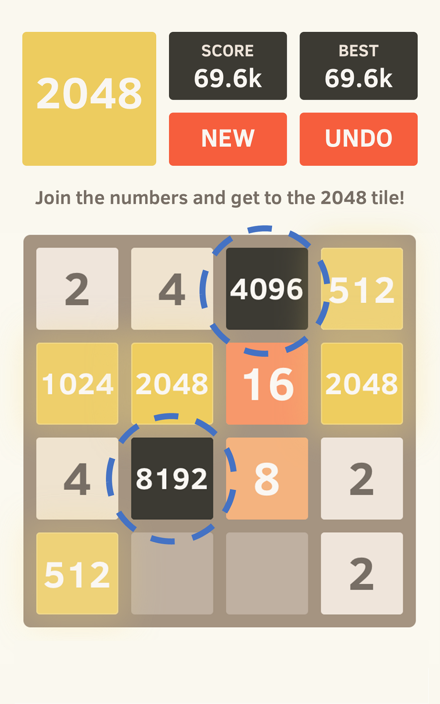
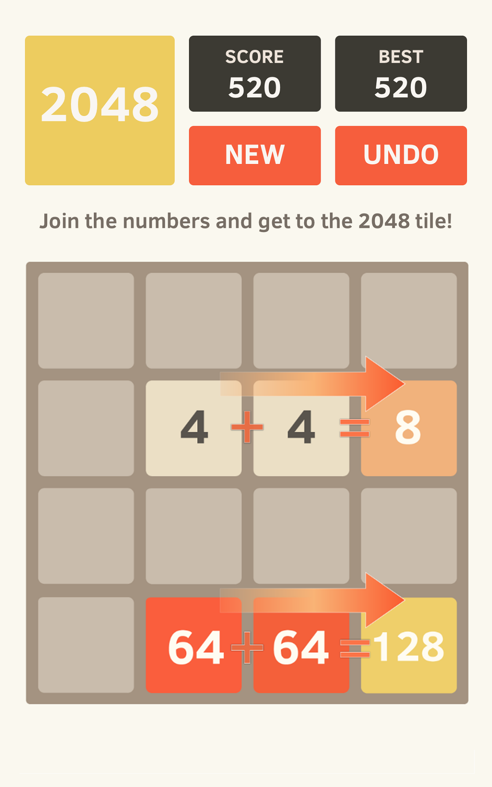

# 2048 Commercial Edition 🚀

A polished, commercial-grade implementation of the classic 2048 puzzle game built with **Flutter**. This project is optimized for production, featuring a modern UI, high-performance gesture handling, and full Google AdMob integration.

## ✨ Features

- **Modern Visuals:** Styled with the classic 2048 aesthetic using the **Rubik** font family for a premium feel.
- **Optimized Performance:** Custom-built game board using `Stack` and `Positioned` widgets to ensure smooth animations and zero gesture conflicts.
- **Responsive Gestures:** Advanced velocity-based swipe detection (Up, Down, Left, Right).
- **Monetization Ready:** Pre-integrated with **Google Mobile Ads (AdMob)**:
  - Persistent **Banner Ads** at the bottom.
  - **Interstitial Ads** triggered on Game Over.
- **Persistence:** High-score tracking using `shared_preferences`.
- **Game Logic:**
  - Smooth tile pop and scale animations.
  - Dedicated "Win" and "Game Over" states.
  - "Keep Playing" mode after reaching the 2048 tile.

## 📱 Screenshots

| Game Play | Game Over | Win Screen |
|---|---|---|
|  |  |  |

## 🛠 Tech Stack

- **Framework:** [Flutter](https://flutter.dev)
- **Language:** Dart
- **Ads:** `google_mobile_ads`
- **Storage:** `shared_preferences`
- **Typography:** Rubik (Regular, SemiBold, Bold)

## 🚀 Getting Started

### Prerequisites
- Flutter SDK (Latest Stable)
- Android Studio / Xcode
- AdMob Account

### Installation

1. **Clone the repository:**
   ```bash
   git clone https://github.com/yourusername/game_2048.git
   cd game_2048
   ```

2. **Install dependencies:**
   ```bash
   flutter pub get
   ```

3. **AdMob Configuration:**
   - Update `APPLICATION_ID` in `android/app/src/main/AndroidManifest.xml`.
   - Update `GADApplicationIdentifier` in `ios/Runner/Info.plist`.
   - Replace unit IDs in `lib/main.dart`.

4. **Run the app:**
   ```bash
   flutter run
   ```

## 🏗 Project Structure

```text
lib/
└── main.dart        # Primary game logic, UI, and AdMob lifecycle
android/             # Android specific configurations & Manifest
ios/                 # iOS specific configurations & Info.plist
UI/
├── Fonts/           # Rubik font assets
└── Screenshots/     # Visual references and mockups
```

## 📄 License

This project is licensed under the MIT License - see the [LICENSE](LICENSE) file for details.
